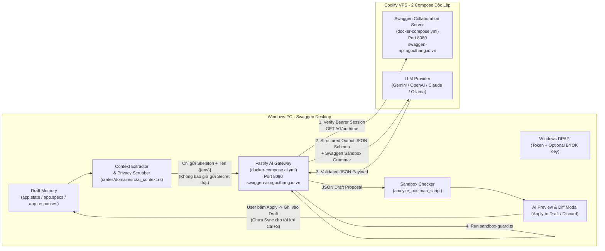

# SUPER PLAN: Tích hợp Swaggen AI Copilot & Fastify AI Gateway (`apps/ai-gateway`)

> **Tài liệu thiết kế & lộ trình kỹ thuật chi tiết** — Chưa triển khai code (Pre-implementation Blueprint).  
> **Mục tiêu**: Biến dữ liệu **Bộ nhớ Draft cục bộ** (`WorkspaceState`, `SpecDocument`, `HttpResponseData`) thành ngữ cảnh chuẩn xác cho AI để tự thiết kế OpenAPI/Collections/Mock, tự viết Pre-request & Post-response Script tương thích 100% với Rust Sandbox của Swaggen, sinh Edge-Case Test Suite và chẩn đoán lỗi API.  
> **Kiến trúc triển khai**: Nằm chung monorepo `d:\code\potmen`, nhưng chạy **Fastify (Node.js/TypeScript)** thành một service hoàn toàn độc lập với file **`docker-compose.ai.yml` riêng**, không đụng chạm tới `docker-compose.yml` hay `Dockerfile` của `swaggen-server` (Rust).

---

## 1. Tầm nhìn & Bối cảnh hiện tại của Repo

Hiện tại Swaggen (`v0.1.24` / `v1.0.0-early-access`) đã hoàn thiện nền tảng chuẩn công nghiệp:
- **Desktop (`apps/desktop`)**: Native Windows Rust (`eframe`/`egui`), lưu toàn bộ Draft cục bộ tại `%LOCALAPPDATA%\Swaggen\<workspace>\` (`workspace.journal`, `specs.journal`, `history.journal`, `secrets.journal` mã hoá **Windows DPAPI**) hoặc `.\data\` (chế độ Portable).
- **Backend Cộng tác (`apps/server`)**: Rust + `axum 0.8.9` + MongoDB Replica Set ACID Transactions, deploy qua `docker-compose.yml` + `Dockerfile` lên Coolify (`swaggen-api.ngocthang.io.vn`).
- **Engine Phân tích & Sandbox (`crates/spec-engine`, `crates/runner`)**:
  - `swaggen-spec-engine::openapi`: Parse & validate OpenAPI 3.0/3.1, Swagger 2.0, Postman JSON, Swagger HTML (`SpecDocument`, `SpecOperation`, `SpecSchemaSummary`), sinh request mẫu qua `generate_linked_request`.
  - `swaggen-runner::sandbox`: Thực thi JS Pre-request & Post-response hoàn toàn bằng Rust thuần không cần Node runtime, có hàm `analyze_postman_script(script)` để phát hiện API bị cấm (`pm.sendRequest`, `require()`, `eval()`, `setTimeout`, `xml2Json`).
  - `swaggen-runner::local_mock`: Tạo Mock Server từ `SpecDocument` và `MockScenarioRule`.
  - `swaggen-domain::security`: Bộ lọc `RedactionPolicy`, `sanitize_headers`, `sanitize_url_query`, `sanitize_text`.

**Khoảng trống cần lấp đầy**: Mọi dữ liệu API, Schema và Response thật đã nằm sẵn ở máy người dùng, nhưng việc thiết kế API mới từ mô tả, viết test script `pm.*`, trích xuất biến tự động và tạo hàng loạt test case biên vẫn đang làm thủ công.

---

## 2. Kiến trúc Tổng thể & Cô lập Hạ tầng (`Separate Compose`)

### 2.1. Bố cục thư mục trong cùng Monorepo

```text
d:\code\potmen\
├── Dockerfile                          # [GIỮ NGUYÊN] Build Rust swaggen-server
├── docker-compose.yml                  # [GIỮ NGUYÊN] Deploy Rust swaggen-server trên Coolify
├── .env.example                        # [GIỮ NGUYÊN] Biến môi trường của Rust server
│
├── docker-compose.ai.yml               # [MỚI] File Compose riêng cho Fastify AI Gateway
├── apps/
│   ├── desktop/                        # Mở rộng UI Copilot Drawer + Context Extractor
│   ├── server/                         # Bổ sung duy nhất GET /v1/auth/me (introspect phiên)
│   └── ai-gateway/                     # [MỚI] Service Fastify + TypeScript + Zod + AI SDK
│       ├── Dockerfile                  # Node 22 Alpine multi-stage siêu nhẹ (~140MB image)
│       ├── .dockerignore
│       ├── .env.example                # PORT, LLM keys, SWAGGEN_SERVER_URL, CORS, RATE_LIMIT
│       ├── package.json
│       ├── tsconfig.json
│       ├── vitest.config.ts
│       └── src/
│           ├── server.ts               # Fastify bootstrap, Helmet, CORS, Rate Limit, Healthcheck
│           ├── config/env.ts           # Validate biến môi trường bằng Zod lúc khởi động
│           ├── middleware/
│           │   ├── auth.ts             # Xác thực Bearer Swaggen Token hoặc BYOK Key
│           │   └── quota.ts            # Giới hạn lượt gọi/ngày + circuit breaker
│           ├── providers/
│           │   ├── router.ts           # Chọn provider (Gemini / OpenAI / Anthropic / Local Ollama)
│           │   ├── gemini.adapter.ts
│           │   └── openai.adapter.ts
│           ├── schemas/                # Zod Schemas ép LLM trả về 100% đúng struct Rust
│           │   ├── context.schema.ts   # Đầu vào Draft Context đã ẩn danh từ Desktop
│           │   ├── design.schema.ts    # Đầu ra OpenAPI 3.1 + Collections + Mock Routes
│           │   ├── script.schema.ts    # Đầu ra Pre/Post Script + Assertions + Compatibility
│           │   ├── testgen.schema.ts   # Đầu ra Edge-case Test Cases cho Collection Runner
│           │   └── diagnose.schema.ts  # Đầu ra chẩn đoán lỗi & bản vá Request
│           ├── prompts/                # System Prompt chuyên biệt + Ngữ pháp Sandbox Swaggen
│           ├── validators/
│           │   └── sandbox-guard.ts    # Quét AST/regex chặn API cấm trước khi trả Desktop
│           └── routes/
│               ├── health.ts           # GET /health/live, GET /health/ready
│               ├── design-api.ts       # POST /ai/v1/design-api
│               ├── generate-script.ts  # POST /ai/v1/generate-script
│               ├── generate-tests.ts   # POST /ai/v1/generate-edge-cases
│               └── diagnose-error.ts   # POST /ai/v1/diagnose-response
│
├── crates/
│   └── domain/src/ai_context.rs        # [MỚI] Trích xuất & ẩn danh Draft Memory chuẩn Rust
└── .github/workflows/
    ├── deploy-coolify.yml              # [GIỮ NGUYÊN] Chỉ deploy Rust server
    └── deploy-ai-coolify.yml           # [MỚI] Chỉ chạy test Node & deploy AI khi đụng apps/ai-gateway/**
```

### 2.2. Sơ đồ luồng dữ liệu tổng thể (`Draft-First` & `Zero-Secret-Leak`)



---

## 3. Thiết kế Lớp Bảo mật & Khai thác Bộ nhớ Draft (`ai_context.rs`)

Đây là **trái tim an toàn** của hệ thống để giải quyết nỗi lo lộ token, nặng token hoặc AI bịa sai trường JSON.

### 3.1. Nguyên tắc 5 KHÔNG khi gửi Draft Memory lên Fastify
1. **KHÔNG gửi giá trị Secret**: Mọi `VariableEntry` có `is_secret == true` hoặc có `secret_ref`, mọi `PersonalVarOverride`, mọi giá trị thật của `Authorization`, `Cookie`, `Set-Cookie`, `X-Api-Key` trong `RequestItem` đều bị thay bằng tên biến `{{key}}` hoặc `"[REDACTED]"`.
2. **KHÔNG gửi dữ liệu người dùng thật trong Response**: Thay vì ném 500 KB JSON response thật lên LLM, hàm `build_json_shape_summary(&bytes)` tự chuyển payload thành **Cây kiểu dữ liệu (JSON Type Skeleton)** kèm giá trị mẫu tối đa 24 ký tự cho trường không nhạy cảm (vd: `"role": "admin"`, `"id": "<uuid>"`, `"items": [ { "price": "<number>", "sku": "<string>" } ]`), giới hạn tối đa **4 cấp độ sâu** và **60 fields**.
3. **KHÔNG gửi toàn bộ 200 endpoint trong Swagger**: Khi dùng chức năng viết script hoặc chẩn đoán lỗi, Desktop chỉ lọc:
   - Operation đang khớp (theo `linked_operation_uid` hoặc method+path),
   - Tối đa 5 endpoint cùng `tag` trong `SpecDocument` (ví dụ cùng tag `Auth` hoặc `Orders`),
   - Các `SpecSchemaSummary` mà endpoint đó tham chiếu tới.
4. **KHÔNG ghi đè trực tiếp lên Workspace đang chạy**: Mọi kết quả AI trả về đều đi qua **Preview / Diff Card** (người dùng xem rõ từng API / dòng code mới trước khi bấm `Apply to Draft`).
5. **KHÔNG tự động sync lên MongoDB**: Kể cả trong Team Workspace, kết quả sau khi bấm Apply vẫn chỉ nằm ở **Draft cục bộ** cho tới khi người dùng kiểm thử xong và bấm `Ctrl + S`.

### 3.2. Gói dữ liệu `AiContextBundle` gửi từ Desktop sang Fastify

```json
{
  "schema_version": "1.0",
  "workspace_kind": "Team",
  "available_env_vars": [
    { "key": "base_url", "is_secret": false, "sample_hint": "https://api.staging..." },
    { "key": "access_token", "is_secret": true, "sample_hint": null }
  ],
  "collection_vars": ["api_prefix", "default_page_size"],
  "active_request": {
    "name": "Login",
    "method": "POST",
    "url": "{{base_url}}/api/auth/login",
    "path_params": [],
    "query_params": [],
    "header_keys": ["Content-Type", "X-Request-Id"],
    "body_shape": { "email": "<string>", "password": "[REDACTED]" },
    "existing_pre_script": "",
    "existing_post_script": ""
  },
  "last_response_summary": {
    "status_code": 200,
    "duration_ms": 142,
    "header_keys": ["content-type", "set-cookie", "x-ratelimit-remaining"],
    "body_shape": {
      "success": "<boolean>",
      "data": {
        "user": { "id": "<string>", "email": "<string>" },
        "tokens": { "accessToken": "[REDACTED_STRING]", "expiresIn": "<number>" }
      }
    }
  },
  "spec_excerpt": {
    "title": "Booking API",
    "version": "1.0.0",
    "security_schemes": ["bearerAuth"],
    "related_operations": [],
    "related_schemas": []
  }
}
```

---

## 4. Đặc tả Chi tiết 4 Tính năng AI Cốt lõi & Hợp đồng API (`Fastify <-> Desktop`)

### 4.1. Ngữ pháp Sandbox Bắt buộc (Strict Prompt Contract cho Script)

Dựa trên kiểm tra thực tế tại [sandbox.rs](file:///d:/code/potmen/crates/runner/src/sandbox.rs), AI **CHỈ ĐƯỢC PHÉP** dùng đúng tập lệnh mà Swaggen hỗ trợ:

| Nhóm API | Cú pháp hợp lệ 100% trong Swaggen Sandbox | Cú pháp BỊ CẤM (Sandbox Guard sẽ loại bỏ) |
| :--- | :--- | :--- |
| **Test & Status** | `pm.test("...", () => { ... })`, `test("...", () => { ... })`, `pm.response.to.have.status(200)` | `pm.sendRequest(...)` |
| **Assertions** | `pm.expect(x).to.eql(y)`, `.to.include(...)`, `.to.be.above(...)`, `.to.be.an("array")`, `expect(x).toBe(y)` | `require(...)`, `import ...` |
| **Đọc Response** | `const data = pm.response.json()`, `pm.response.code`, `pm.response.responseTime`, `pm.response.headers.get("...")` | `xml2Json(...)`, `cheerio` |
| **Biến Môi trường** | `pm.environment.set("k", v)`, `pm.environment.get("k")`, `pm.collectionVariables.set(...)`, `pm.globals.set(...)` | `pm.variables.replaceIn` phức tạp |
| **Pre-request Động** | `pm.request.headers.upsert("X-Trace", ...)` , `crypto.randomUUID()`, `Date.now()` | `setTimeout`, `setInterval`, `fs.*`, `eval()` |

*Tầng `validators/sandbox-guard.ts` trên Fastify + `analyze_postman_script()` trên Desktop tạo thành **2 lớp lọc kép**: nếu LLM lỡ sinh ra hàm cấm, Fastify tự động ép LLM sửa lại (tối đa 1 lần retry) trước khi trả về cho Desktop.*

---

### 4.2. Chi tiết 4 Endpoint của Fastify AI Gateway

#### Endpoint 1: `POST /ai/v1/design-api` — AI Thiết kế trọn bộ API + Mock + Collection
- **Input từ Desktop**:
  - `prompt`: Mô tả nghiệp vụ tự nhiên (hoặc dán thẳng Prisma schema / Mongoose schema / SQL DDL / ghi chú Notion).
  - `style`: `"rest"` | `"graphql"` | `"mixed"`.
  - `include_mock_routes`: `true | false`.
  - `context`: `AiContextBundle` (để tái sử dụng `{{base_url}}`, auth scheme và tránh trùng path đang có).
- **Output JSON Schema (Zod ép kiểu)**:
  - `openapi_spec_yaml`: Chuỗi OpenAPI `3.0.3` / `3.1.0` hoàn chỉnh (hợp lệ với parser của `crates/spec-engine/src/openapi.rs`).
  - `collection_name` & `suggested_color`: Tên collection + màu (`blue`, `emerald`, ...).
  - `requests[]`: Mảng request chuẩn để map thẳng vào `RequestItem`:
    - `folder_path`, `name`, `method`, `url_template` (dùng sẵn `{{base_url}}` & `:id`),
    - `query_params[]`, `path_params[]`, `headers[]`, `body_json`, `auth`,
    - `recommended_assertions[]` (`StatusEquals`, `MaxDurationMs`, `JsonPathEquals`),
    - `recommended_post_script` (tự động trích token ở request Login lưu vào `{{access_token}}`!).
  - `env_variables_needed[]`: Danh sách biến cần tạo thêm vào Environment (kèm cờ `is_secret: true` cho token/password).
  - `mock_routes[]`: Payload cấu hình sẵn cho `MockRoute` / `CreateTeamMockRequest` để bấm test Mock ngay lập tức.
- **Hành động trên Desktop sau khi Preview**:
  - Nút **`Apply Collection & Spec to Draft`**: Nạp Spec vào tab **API Documentation**, tạo Collection + Folders + Requests vào Sidebar (mặc định mở sẵn tab đầu tiên để test), tự bổ sung biến thiếu vào Active Environment.
  - Nút **`Start Local Mock & Test`**: Bật luôn Local Mock Server theo `mock_routes[]` vừa sinh để user chạy thử trọn chuỗi CRUD ngay trên máy.

#### Endpoint 2: `POST /ai/v1/generate-script` — AI Viết Pre-request / Post-response Script & Assertions
- **Input từ Desktop**:
  - `target_stage`: `"pre_request"` | `"post_response"` | `"both"`.
  - `instruction`: Yêu cầu người dùng (vd: *"Tạo X-Request-Nonce ngẫu nhiên trước khi gửi; sau khi nhận 200 thì kiểm tra pagination hợp lệ và lưu userId đầu tiên vào biến collection"*).
  - `context`: `AiContextBundle` (có sẵn `body_shape` của Response vừa gọi!).
- **Output JSON Schema**:
  - `pre_request_script`: Code JS thuần chuẩn `pm.*`.
  - `post_response_script`: Code JS thuần chuẩn `pm.*` / `expect()`.
  - `declarative_assertions[]`: Danh sách `AssertionRule` gợi ý thêm cho tab **Assertions** (trực quan, không cần viết code).
  - `extractors[]`: Danh sách `ResponseExtractorRule` gợi ý.
  - `explanation`: Giải thích ngắn từng dòng code làm gì.
- **Hành động trên Desktop**:
  - Mở diff 2 cột *(Code hiện tại | Code AI đề xuất)* kèm badge kết quả kiểm tra `analyze_postman_script()` (`0 unsupported APIs`).
  - Bấm **Apply** / **Append** để chép thẳng vào `req.pre_request_script` hoặc `req.post_response_script` trong Draft.

#### Endpoint 3: `POST /ai/v1/generate-edge-cases` — AI Sinh Bộ Test Case Biên cho Collection Runner
- **Input từ Desktop**:
  - `base_request` (từ `active_request` + `spec_excerpt` nếu có).
  - `scenarios`: `["missing_required_fields", "invalid_types", "unauthorized_401", "boundary_values", "idempotency_replay"]`.
- **Output JSON Schema**:
  - `test_cases[]`: 4–8 biến thể `RequestItem` + expected status (`400`, `401`, `404`, `422`, `409`) + `post_response_script` assert đúng status & schema lỗi.
- **Hành động trên Desktop**:
  - Tạo thành 1 folder con `[AI Edge Cases] <tên request>` trong Collection Draft để chạy 1 click bằng **Collection Runner** và xuất JUnit/JSON report.

#### Endpoint 4: `POST /ai/v1/diagnose-response` — AI Chẩn đoán lỗi HTTP (`4xx/5xx`) & Đề xuất sửa
- **Input từ Desktop**:
  - `context` chứa Request vừa gửi + Response lỗi đã redact + đoạn OpenAPI Schema tương ứng trong `app.specs`.
- **Output JSON Schema**:
  - `root_cause`: Nguyên nhân cụ thể (vd: *"API yêu cầu header `Content-Type: application/json` nhưng đang gửi `text/plain`, hoặc trường `checkInDate` sai format ISO-8601"*).
  - `patch_suggestions`: Đề xuất thay đổi cụ thể (sửa URL, thêm Header, sửa JSON body, hoặc đổi Auth).
- **Hành động trên Desktop**:
  - Nút **`Apply Fix & Retry`** sửa bản nháp Request theo `patch_suggestions` và cho user bấm **Send** kiểm tra lại ngay.

---

## 5. Xác thực, Phân quyền & Cơ chế BYOK (Bring Your Own Key)

Để bạn **không bị lộ API Key AI** và **không phải gánh 100% chi phí token của tất cả người dùng**:

### Chế độ 1: Managed AI (Dành cho người dùng đã đăng nhập Swaggen Server)
1. User đăng nhập Swaggen Desktop bằng Google/Email -> có `session_id` Bearer Token từ `swaggen-server`.
2. Desktop gửi request lên Fastify kèm header `Authorization: Bearer <session_token>`.
3. Fastify gọi về Rust Server (`GET ${SWAGGEN_SERVER_URL}/v1/auth/me` — **cần bổ sung endpoint nhẹ này trên `apps/server`**, cache kết quả theo SHA-256 token trong RAM 60 giây) để lấy `user_id`, `email`.
4. Fastify kiểm tra **Rate Limit & Daily Quota** (ví dụ 30 lượt AI / user / ngày), rồi dùng Server LLM Key (`GEMINI_API_KEY` hoặc `OPENAI_API_KEY` lưu trên Coolify Env) để xử lý.

### Chế độ 2: BYOK — Bring Your Own Key (Cho người dùng Personal/Offline hoặc dùng vượt quota)
1. Người dùng vào **Settings → AI Copilot** trên Desktop, chọn Provider (`Google Gemini`, `OpenAI`, `Custom OpenAI-Compatible / Ollama localhost`), nhập API Key riêng của họ.
2. Key được lưu **hoàn toàn cục bộ trên Windows bằng DPAPI** (`crates/secret-store`), tuyệt đối **không** sync lên MongoDB.
3. Khi gọi Fastify Gateway, Desktop gửi qua header `X-AI-Provider: gemini` + `X-AI-Provider-Key: <key>` (hoặc gọi trực tiếp Ollama `http://127.0.0.1:11434` nếu user chọn Local LLM). Fastify dùng xong **huỷ khỏi bộ nhớ ngay lập tức, không log, không lưu DB**, và không trừ quota hệ thống.

---

## 6. Cấu hình Docker & Compose Riêng Biệt (`docker-compose.ai.yml`)

### 6.1. Thiết kế file `docker-compose.ai.yml` (ở thư mục gốc repo, tách biệt hoàn toàn với `docker-compose.yml`)

```yaml
services:
  swaggen-ai-gateway:
    build:
      context: ./apps/ai-gateway
      dockerfile: Dockerfile
    environment:
      NODE_ENV: production
      AI_BIND_HOST: "0.0.0.0"
      AI_PORT: "8090"
      # Địa chỉ Rust collaboration server để xác thực Bearer session token
      SWAGGEN_SERVER_URL: "${SWAGGEN_SERVER_URL:-https://swaggen-api.ngocthang.io.vn}"
      # Provider mặc định của server (gemini | openai)
      AI_DEFAULT_PROVIDER: "${AI_DEFAULT_PROVIDER:-gemini}"
      AI_DEFAULT_MODEL: "${AI_DEFAULT_MODEL:-gemini-2.5-flash}"
      GEMINI_API_KEY: "${GEMINI_API_KEY:-}"
      OPENAI_API_KEY: "${OPENAI_API_KEY:-}"
      # Giới hạn & Bảo mật
      AI_DAILY_QUOTA_FREE: "${AI_DAILY_QUOTA_FREE:-30}"
      AI_MAX_CONTEXT_BYTES: "${AI_MAX_CONTEXT_BYTES:-131072}"
      AI_TRUST_BYOK_HEADERS: "${AI_TRUST_BYOK_HEADERS:-true}"
    expose:
      - "8090"
    ports:
      - "127.0.0.1:${SWAGGEN_AI_PORT:-8090}:8090"
    read_only: true
    tmpfs:
      - /tmp
    restart: unless-stopped
    mem_limit: 512m
    healthcheck:
      test: ["CMD", "wget", "-qO-", "http://127.0.0.1:8090/health/ready"]
      interval: 30s
      timeout: 5s
      retries: 3
      start_period: 10s
```

### 6.2. Thiết lập trên Coolify VPS (Chạy song song không đụng chạm Rust Backend)
1. **Service 1 (Hiện có — Không thay đổi)**:
   - Coolify Application: `swaggen-api.ngocthang.io.vn`
   - Build Pack: Docker Compose → Location: **`/docker-compose.yml`**
2. **Service 2 (Mới — Tạo thêm Resource riêng)**:
   - Trỏ cùng Git Repo `Thangwibu1/rust-swaggen` (nhánh `main`)
   - Build Pack: Docker Compose → Base Directory: `/` → **Docker Compose Location**: **`/docker-compose.ai.yml`**
   - Domain: `https://swaggen-ai.ngocthang.io.vn` trỏ vào port `8090`.
   - Khai báo Env riêng trên Coolify cho service này (`SWAGGEN_SERVER_URL`, `GEMINI_API_KEY` / `OPENAI_API_KEY`, `AI_DEFAULT_MODEL`).
   - Tắt *Auto Deploy* nếu dùng GitHub Actions webhook riêng `COOLIFY_AI_WEBHOOK_URL` trong `.github/workflows/deploy-ai-coolify.yml` (chỉ build lại khi sửa `apps/ai-gateway/**` hoặc `docker-compose.ai.yml`, tiết kiệm CPU VPS).

### 6.3. Đảm bảo không làm vỡ Build của Rust Backend
- Hiện tại [`.dockerignore`](file:///d:/code/potmen/.dockerignore) ở gốc repo đã có dòng `docker-compose*.yml`.
- Với [Dockerfile](file:///d:/code/potmen/Dockerfile) của Rust: hiện đang `COPY apps ./apps`. Khi thêm `apps/ai-gateway/` chứa `node_modules` ở máy dev, **BẮT BUỘC** bổ sung vào `.dockerignore` ở gốc repo:
  ```gitignore
  apps/ai-gateway/
  ```
  Nhờ dòng này, mỗi lần build container Rust `swaggen-server`, Docker **không copy** code Node.js hay `node_modules` vào context Rust, giữ nguyên tốc độ build và image size của Rust server!

---

## 7. Giao diện người dùng trên Swaggen Desktop (`apps/desktop`)

Tuân thủ tuyệt đối chuẩn UI hiện tại (**Pure White Surface + JetBrains Mono + Tiếng Anh đồng bộ trên app**):

1. **Nút AI Copilot (`✨ AI`) ở 3 điểm chạm đúng ngữ cảnh**:
   - **Điểm 1 — Sidebar (`Collections + ✨ AI Designer`)**: Mở modal/drawer **AI API Designer** -> nhập prompt hoặc dán DB Schema -> chọn `Design REST/GraphQL + Mock` -> Preview cây endpoints -> `Apply to Draft`.
   - **Điểm 2 — Tab `Scripts` & Tab `Assertions` trong Request Composer**: Ô prompt gọn 1 dòng bên trên trình soạn code: `"Ask AI to generate Pre/Post script (using response schema)..."` + nút `Generate Script` -> hiện Diff & badge `Sandbox Verified ✓` -> `Apply` / `Replace`.
   - **Điểm 3 — Response Pane khi gặp HTTP `4xx / 5xx`**: Hiện nút **`✨ Diagnose & Fix`** cạnh status code -> giải thích nguyên nhân + nút `Apply Suggested Fix`.
2. **Settings → AI Copilot**:
   - Nhập **AI Gateway URL** (mặc định `https://swaggen-ai.ngocthang.io.vn`, hoặc `http://127.0.0.1:8090` khi dev local).
   - Chế độ **Server Managed (Signed-in)** vs **Use Own API Key (BYOK - Windows DPAPI)** + công tắc **Local Ollama (`http://127.0.0.1:11434`)**.
   - Công tắc **Preview Redacted Context before sending**: Cho phép user kiểm tra tận mắt đúng JSON đã che mật khẩu trước khi gửi đi.

---

## 8. Lộ trình Triển khai theo Từng Pha (Implementation Roadmap)

| Pha | Hạng mục | Đầu ra cụ thể & Tiêu chí hoàn tất (Acceptance Criteria) |
| :--- | :--- | :--- |
| **Phase A0: Guardrail & Auth Introspect** | • Thêm `apps/ai-gateway/` vào `.dockerignore` gốc.<br>• Thêm endpoint `GET /v1/auth/me` trong `apps/server/src/lib.rs` (trả `user_id`, `email`, `display_name` từ `require_auth`). | • `cargo test -p swaggen-server` pass.<br>• Build `Dockerfile` Rust không copy thư mục `ai-gateway`. |
| **Phase A1: Fastify AI Gateway Core & Compose** | • Khởi tạo `apps/ai-gateway` (Fastify 5, TypeScript, Zod, `@google/genai`, `openai`, Vitest).<br>• Tạo `docker-compose.ai.yml` & `apps/ai-gateway/Dockerfile`.<br>• Viết `auth.ts` (verify `Bearer` qua `/v1/auth/me` + BYOK), `sandbox-guard.ts`, `/health/live`, `/health/ready`. | • `docker compose -f docker-compose.ai.yml up --build` chạy khoẻ trên port `8090`.<br>• Test Vitest verify reject token giả (`401`) và chặn `pm.sendRequest` / `eval(` trong output. |
| **Phase A2: `crates/domain/src/ai_context.rs`** | • Viết bộ trích xuất Draft Memory (`AiContextBundle`) + `build_json_shape_summary` + redaction.<br>• Viết unit test chứng minh API key, cookie, password trong Draft không bao giờ lọt vào JSON output. | • `cargo test -p swaggen-domain` pass 100% test bảo mật redaction. |
| **Phase A3: AI Script & Edge-Case Engine** | • Triển khai `/ai/v1/generate-script`, `/ai/v1/generate-edge-cases`, `/ai/v1/diagnose-response` trên Fastify.<br>• Tích hợp UI vào tab **Scripts** & **Response Pane** trên `apps/desktop`. | • Gọi Login nhận Response -> bấm AI Generate Script -> code chạy qua `analyze_postman_script` với `0` lỗi và chạy thực tế lưu `{{api_token}}` thành công. |
| **Phase A4: AI API Designer & Local Mock** | • Triển khai `/ai/v1/design-api` trên Fastify.<br>• Tích hợp **AI API Designer Modal** trên Sidebar + 1-click tạo Collection, OpenAPI Docs và khởi chạy Local Mock Server. | • Nhập mô tả hệ thống bất kỳ -> tạo ra Spec + Collection + chạy thử ngay qua Local Mock Server trả HTTP `200/201`. |
| **Phase A5: Settings BYOK + CI/CD Coolify** | • Thêm UI **Settings → AI Copilot** (lưu BYOK key vào Windows DPAPI `SecretStore` + Preview Context).<br>• Tạo `.github/workflows/deploy-ai-coolify.yml`. | • Deploy độc lập `swaggen-ai.ngocthang.io.vn` trên Coolify thành công, không ảnh hưởng uptime của `swaggen-api.ngocthang.io.vn`. |

---

## 9. Rủi ro kỹ thuật & Phương án phòng tránh

1. **Rủi ro AI viết code Postman không chạy được trong Swaggen Sandbox**:
   - *Phòng tránh*: Đưa danh sách API hợp lệ + 5 ví dụ mẫu (`pm.test`, `pm.response.json()`, `pm.environment.set`, `pm.request.headers.upsert`) vào System Prompt; kiểm tra đầu ra bằng `sandbox-guard.ts` ở Fastify và `analyze_postman_script()` ở Desktop trước khi hiển thị nút **Apply**.
2. **Rủi ro AI tự sửa hoặc phá hỏng Collection hiện có**:
   - *Phòng tránh*: Nguyên tắc **Draft-Only + Diff Preview** — AI chỉ đề xuất thêm/sửa trên UI Preview, người dùng tự bấm `Apply to Draft`, và vẫn có thể dùng **Ctrl+S Publish History / Cherry-Pick** để khôi phục nếu đã lỡ publish lên Team.
3. **Rủi ro nghẽn mạng / Token LLM tốn kém**:
   - *Phòng tránh*: Cắt ngữ cảnh theo *JSON Shape Skeleton* (giảm 70–90% số lượng token đầu vào so với gửi raw response), đặt timeout 30s trên client + retry nút bấm thủ công, giới hạn quota/user và hỗ trợ **BYOK / Ollama Offline**.
4. **Rủi ro xung đột Deploy trên Coolify**:
   - *Phòng tránh*: Tách tuyệt đối `docker-compose.yml` (port `8080`, Rust) và `docker-compose.ai.yml` (port `8090`, Fastify), khác `.dockerignore`, khác GitHub Actions path-filter workflow.
