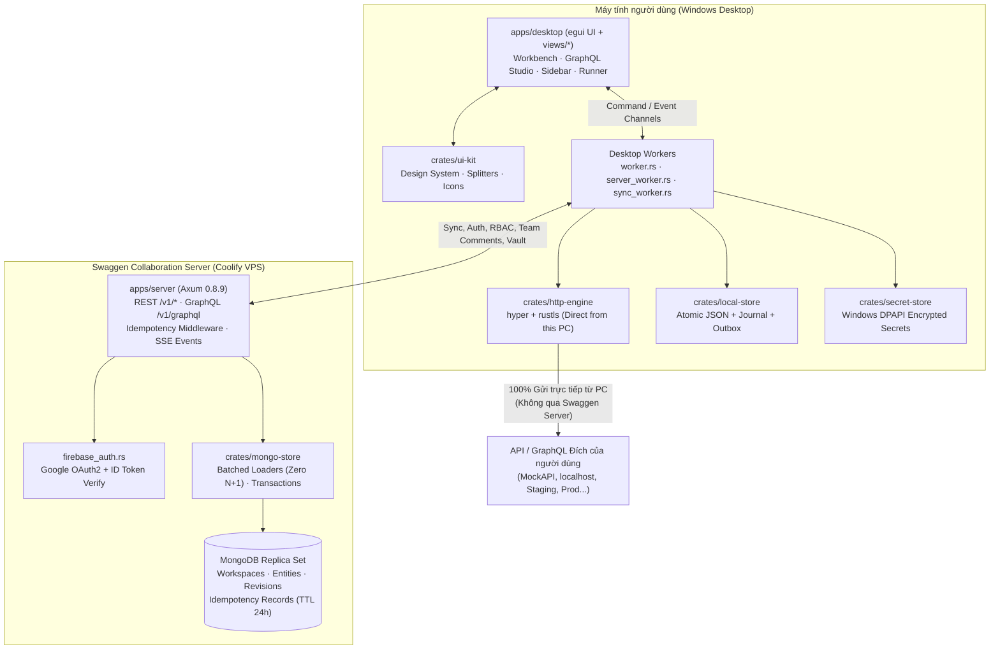

# Swaggen — Tài liệu Kiến trúc Hệ thống & Tổng hợp Tính năng (`v0.1.15`)

> **Swaggen** là nền tảng kiểm thử, thiết kế và cộng tác API (REST, GraphQL, SSE, OpenAPI) viết hoàn toàn bằng **Rust** (`edition = "2024"`, MSRV `1.100`) theo kiến trúc **Windows Native Desktop + Cloud Collaboration Backend**.
>
> Nguyên tắc cốt lõi: mọi request API/GraphQL từ Workbench đều được thực thi **trực tiếp từ máy tính của người dùng (`Direct from this PC`)** qua Rust HTTP engine nội bộ (`hyper` + `rustls`), không đi qua server trung gian; dữ liệu cục bộ được lưu bền vững theo cơ chế atomic journal và bảo vệ bí mật bằng **Windows DPAPI**.

---

## 1. Tech Stack & Phiên bản chính

| Tầng | Công nghệ / Crate | Vai trò |
| :--- | :--- | :--- |
| **Desktop UI (Frontend)** | `eframe` / `egui 0.37.0` (`wgpu`, `accesskit`) | Giao diện Native Windows Pure White Surface, không dùng WebView/Electron |
| **HTTP Client Engine** | `hyper 1.13.0`, `hyper-util 0.1.21`, `tokio-rustls 0.26.6`, `rustls 0.23.46` | Thực thi HTTP/1.1, TLS 1.2/1.3, Streaming, Redirects, Multipart, OAuth2 PKCE |
| **Backend API Server** | `axum 0.8.9`, `tokio 1.54.1` | REST API (`/v1/*`), GraphQL (`/v1/graphql`), SSE realtime, Team Mock |
| **Database & Transactions** | `mongodb 3.10.2`, `bson 2.15.0` | MongoDB Replica Set Multi-Document ACID Transactions + In-Memory Store cho test |
| **Bảo mật & Mật mã** | `windows-sys 0.61.2` (DPAPI), `argon2 0.5.3`, `sha2 0.11.1`, `hmac 0.13.0`, `ring 0.17.14` | Bảo vệ secret trên Windows, băm mật khẩu Argon2id, ký số & Idempotency SHA-256 |
| **Xác thực** | Firebase Auth (Google Sign-In Loopback PKCE) + Session Token nội bộ | Đăng nhập Google qua trình duyệt, quản lý thiết bị/phiên, TOTP MFA |
| **Hạ tầng triển khai** | Docker, Docker Compose, Coolify VPS, Inno Setup (`.exe`) & WiX (`.msi`) | Đóng gói bộ cài Windows x64 và triển khai Server lên VPS |

---

## 2. Cấu trúc Thư mục Dự án (Workspace Layout)

Dự án được tổ chức theo mô hình **Rust Cargo Workspace** gồm **3 ứng dụng (`apps/`)** và **10 thư viện dùng chung (`crates/`)**:

```text
d:\code\potmen\
├── Cargo.toml                  # Cấu hình Workspace, version (0.1.14) và pin dependency tập trung
├── Dockerfile                  # Build image production cho swaggen-server
├── docker-compose.yml          # Triển khai Server + MongoDB Replica Set
├── 07-operations/              # Hướng dẫn triển khai Coolify VPS & Windows Installer
├── assets/                     # Icon ứng dụng (.ico, .png) và bộ icon Figma (assets/icons/)
├── tools/                      # Script kiểm tra P00-P01, bundle-result.ps1, build-installer.ps1
├── docs/                       # Tài liệu tổng hợp kiến trúc & tính năng
├── result/                     # Output build release theo từng phiên bản (gitignored), vd: result/v0.1.14/
│
├── apps/                       # === CÁC ỨNG DỤNG CHÍNH (BINARIES) ===
│   ├── desktop/                # [FRONTEND] Ứng dụng Windows Desktop (swaggen-desktop.exe)
│   ├── server/                 # [BACKEND]  Cloud Collaboration & GraphQL Server (swaggen-server.exe)
│   └── cli/                    # [CLI]      Headless Runner & Snippet Generator (swaggen-cli.exe)
│
└── crates/                     # === CÁC CRATE DÙNG CHUNG (LIBRARIES) ===
    ├── domain/                 # Thực thể nghiệp vụ, Variable Resolution, GraphQL Parser/Analyzer, Security/SSRF
    ├── api-contract/           # DTO & Schema giao tiếp chung giữa Desktop và Server
    ├── ui-kit/                 # Design System (Tokens, Buttons, Tabs, Splitters, Icons, Code Viewer)
    ├── http-engine/            # Engine gửi HTTP thực tế từ PC + OAuth2 PKCE Loopback
    ├── local-store/            # Lưu trữ bền vững cục bộ (Atomic Write, Journal, Quarantine)
    ├── secret-store/           # Lưu trữ bí mật mã hóa theo user Windows (DPAPI)
    ├── mongo-store/            # Tầng Repository MongoDB (ACID Transactions, Batched Loaders) & InMemoryStore
    ├── spec-engine/            # OpenAPI 3.0/3.1, Swagger 2.0, Postman/cURL/HAR/.http Importer & Assertions
    ├── runner/                 # Collection Runner, Local Mock Server, Sandboxed Script, Code Snippets, SSE
    └── sync/                   # Outbox bền vững, CRDT merge, Conflict Resolution & Offline Sync
```

### Phân biệt rõ vị trí Frontend và Backend

| Thành phần | Thư mục | File đầu vào / Quan trọng | Trách nhiệm |
| :--- | :--- | :--- | :--- |
| **Frontend (Desktop UI)** | [`apps/desktop/`](file:///d:/code/potmen/apps/desktop/src) | [`main.rs`](file:///d:/code/potmen/apps/desktop/src/main.rs), [`app.rs`](file:///d:/code/potmen/apps/desktop/src/app.rs), [`views/`](file:///d:/code/potmen/apps/desktop/src/views) | Toàn bộ giao diện Workbench, Sidebar, GraphQL Studio, Response Inspector, Runners, Sync, Settings |
| **Frontend UI Kit** | [`crates/ui-kit/`](file:///d:/code/potmen/crates/ui-kit/src/lib.rs) | [`lib.rs`](file:///d:/code/potmen/crates/ui-kit/src/lib.rs) | Token màu sắc/typography, splitter kéo thả 1:1, icon SVG/PNG từ Figma, code viewer đánh số dòng |
| **Frontend Background Workers** | [`apps/desktop/src/`](file:///d:/code/potmen/apps/desktop/src) | [`worker.rs`](file:///d:/code/potmen/apps/desktop/src/worker.rs), [`server_worker.rs`](file:///d:/code/potmen/apps/desktop/src/server_worker.rs), [`sync_worker.rs`](file:///d:/code/potmen/apps/desktop/src/sync_worker.rs) | Chạy bất đồng bộ ngoài luồng UI: gửi HTTP cục bộ, mở trình duyệt Google Sign-In, sync team, lưu disk/DPAPI |
| **Backend (API Server)** | [`apps/server/`](file:///d:/code/potmen/apps/server/src) | [`main.rs`](file:///d:/code/potmen/apps/server/src/main.rs), [`lib.rs`](file:///d:/code/potmen/apps/server/src/lib.rs), [`graphql_api.rs`](file:///d:/code/potmen/apps/server/src/graphql_api.rs), [`firebase_auth.rs`](file:///d:/code/potmen/apps/server/src/firebase_auth.rs) | REST API `/v1/*`, GraphQL `/v1/graphql`, Idempotency middleware, Firebase JWT verifier, Team Mock, RBAC |
| **Backend Data Layer** | [`crates/mongo-store/`](file:///d:/code/potmen/crates/mongo-store/src) | [`repo.rs`](file:///d:/code/potmen/crates/mongo-store/src/repo.rs), [`mongo_backend.rs`](file:///d:/code/potmen/crates/mongo-store/src/mongo_backend.rs), [`memory_backend.rs`](file:///d:/code/potmen/crates/mongo-store/src/memory_backend.rs) | `WorkspaceRepository` trait, MongoDB transactions, batched `$in` queries, `idempotency_records`, Argon2id |
| **Shared Contract & Core** | [`crates/domain/`](file:///d:/code/potmen/crates/domain/src), [`crates/api-contract/`](file:///d:/code/potmen/crates/api-contract/src/lib.rs) | [`workspace.rs`](file:///d:/code/potmen/crates/domain/src/workspace.rs), [`graphql.rs`](file:///d:/code/potmen/crates/domain/src/graphql.rs), [`lib.rs`](file:///d:/code/potmen/crates/api-contract/src/lib.rs) | Model chung, parser GraphQL, resolver biến `{{var}}`, sinh `Idempotency-Key`, chính sách bảo mật & SSRF |

---

## 3. Sơ đồ Kiến trúc Tổng thể



---

## 4. Chi tiết Kiến trúc Frontend (`apps/desktop`)

Giao diện Desktop được thiết kế theo mô hình **Actor / Message-Passing** để đảm bảo luồng vẽ UI (`egui` 60fps) **không bao giờ bị đơ** khi gửi mạng hay đọc/ghi ổ đĩa:

- **Main UI State & Shell ([`apps/desktop/src/app.rs`](file:///d:/code/potmen/apps/desktop/src/app.rs))**:
  - Quản lý `WorkspaceState`, `open_tabs`, `responses`, trạng thái dirty (`generation` vs `saved_generation`), phím tắt toàn cục (`Ctrl+K`, `Ctrl+S`, `Ctrl+Enter`, `Ctrl+B`, `Ctrl+P`, `Ctrl+W`) và điều hướng `MainMode`.
- **Các màn hình chính ([`apps/desktop/src/views/`](file:///d:/code/potmen/apps/desktop/src/views/mod.rs))**:
  - [`sidebar.rs`](file:///d:/code/potmen/apps/desktop/src/views/sidebar.rs): Cây Collection/Folder/Request hỗ trợ **kéo-thả (Drag & Drop)** linh hoạt, tìm kiếm theo tên/method/tag, popup menu `⋯` chuẩn `PopupCloseBehavior::CloseOnClickOutside`, khu vực `PERSONAL` có thanh kéo chỉnh chiều cao.
  - [`request_pane.rs`](file:///d:/code/potmen/apps/desktop/src/views/request_pane.rs): Thanh tab request (nút `+` tạo REST, `+ GQL` tạo GraphQL, icon chuyển layout Ngang/Dọc), thanh URL với nút chuyển `REST | GQL`, đồng bộ 2 chiều URL ↔ `Query String` & `Path Params`, ẩn tab `Body` với `GET`/`HEAD`, tab **GraphQL Studio**, Auth, Assertions/Extractors, Settings (`Idempotency-Key` + Proxy/TLS), và Code Preview.
  - [`response_pane.rs`](file:///d:/code/potmen/apps/desktop/src/views/response_pane.rs): Hiển thị Status, TTFB, dung lượng, huy hiệu `Idempotent Replay`, cảnh báo `GQL Errors`, `DB Queries: N (Batched)`, chế độ `Expand` toàn màn hình, Pretty JSON + cây JSONPath, Headers/Cookies, Test Results, Redirect Chain, Diff giữa 2 lần gọi và Save Sanitized Example.
  - [`runner.rs`](file:///d:/code/potmen/apps/desktop/src/views/runner.rs): Collection Runner (CSV/JSON dataset), Local Mock Server + Traffic Logs, GraphQL & SSE Tester, Dev Utilities.
  - [`specs.rs`](file:///d:/code/potmen/apps/desktop/src/views/specs.rs): Trình soạn thảo & kiểm định OpenAPI 3.0/3.1 / Swagger 2.0, diff spec, schema tree, contract validation.
  - [`import_export.rs`](file:///d:/code/potmen/apps/desktop/src/views/import_export.rs): Import cURL, Postman v2.1 (gồm cả GraphQL), HAR, `.http`, xuất workspace sạch secret.
  - [`server.rs`](file:///d:/code/potmen/apps/desktop/src/views/server.rs) & [`welcome.rs`](file:///d:/code/potmen/apps/desktop/src/views/welcome.rs): Quản lý profile Server, đăng nhập Google qua trình duyệt (Firebase Loopback), quản lý Workspace/Members/Invitations/Sessions/MFA.
  - [`sync.rs`](file:///d:/code/potmen/apps/desktop/src/views/sync.rs): Outbox offline, Publish/Pull, giải quyết xung đột (Conflict Resolution), lịch sử revision & khôi phục, Comment thread, Team Vault, Notifications.
  - [`panels.rs`](file:///d:/code/potmen/apps/desktop/src/views/panels.rs): Environments (Production confirm guard), History, Cookies, Windows DPAPI Secrets, Sanitizer, Storage & Migration, Privacy, Shortcuts & Auto-Update.

---

## 5. Chi tiết Kiến trúc Backend (`apps/server` & `crates/mongo-store`)

Backend (`axum 0.8.9`) phục vụ đồng bộ đội nhóm, quản lý quyền, GraphQL API và lưu trữ an toàn trên MongoDB Replica Set:

### Middleware & Bảo vệ tầng HTTP ([`apps/server/src/lib.rs`](file:///d:/code/potmen/apps/server/src/lib.rs))
1. **`attach_request_id`**: Gắn và trả về header `X-Request-Id` để truy vết log đầu-cuối.
2. **`enforce_idempotency_key`**: Áp dụng nguyên tử cho mọi endpoint ghi dữ liệu (`POST`, `PUT`, `PATCH`, `DELETE`, và GraphQL `mutation`, bỏ qua GraphQL `query` chỉ đọc).
   - Băm `(method, path_and_query, body)` bằng SHA-256.
   - Gọi `claim_idempotency` với unique index `{ scope: 1, key: 1 }` trên collection `idempotency_records` (TTL 24h):
     - Trùng key + cùng payload hash → Trả lại response `2xx` đã cache kèm header `X-Idempotent-Replayed: true`.
     - Trùng key + khác payload hash hoặc đang có request song song chưa xong → Trả về **`409 Conflict`**.
     - Request thất bại (`4xx`/`5xx`) → Tự động `release_idempotency` để client có thể sửa và gửi lại.

### Các nhóm Endpoint chính của Backend
- **Health & Metadata**: `/health/live`, `/health/ready`, `/v1/health/metrics`, `/v1/capabilities`.
- **GraphQL API** ([`graphql_api.rs`](file:///d:/code/potmen/apps/server/src/graphql_api.rs)): `GET/POST /v1/graphql` (hỗ trợ `__schema` introspection, chặn mutation trên `GET` với `405`, giới hạn `depth <= 8` & `fields <= 120`, DataLoader batching `batch_load_workspaces_children`).
- **Auth & Sessions**: `/v1/auth/bootstrap-owner`, `/v1/auth/login`, `/v1/auth/firebase`, `/v1/auth/firebase/browser`, `/v1/auth/logout`, `/v1/auth/logout-all`, `/v1/auth/sessions`, `/v1/auth/invitations/accept`, `/v1/auth/mfa/*`.
- **Workspaces, RBAC & Audit**: `/v1/workspaces`, `/v1/workspaces/{id}/members`, `/v1/workspaces/{id}/invitations`, `/v1/workspaces/{id}/audit`, `/v1/workspaces/{id}/quotas`, `/v1/workspaces/{id}/archive`, `/v1/workspaces/{id}/transfer-ownership`, `/v1/workspaces/{id}/leave`.
- **Sync, Branches & Collaboration**: `/v1/workspaces/{id}/entities`, `/v1/workspaces/{id}/publish`, `/v1/workspaces/{id}/changes`, `/v1/workspaces/{id}/snapshot`, `/v1/workspaces/{id}/events` (SSE), `/v1/workspaces/{id}/entities/{eid}/revisions`, `/v1/workspaces/{id}/entities/{eid}/restore`, `/v1/workspaces/{id}/comments/*`, `/v1/workspaces/{id}/notifications/*`, `/v1/workspaces/{id}/branches`, `/v1/workspaces/{id}/merge-requests/*`.
- **Team Vault, Mocks, Runners & Schedules**: `/v1/workspaces/{id}/vault/*`, `/v1/workspaces/{id}/mocks/*`, `/mock/{workspace_id}/{*tail}`, `/v1/workspaces/{id}/runners/*`, `/v1/workspaces/{id}/schedules`, `/v1/security/check-ssrf`.

### Tối ưu Hiệu năng & Zero N+1 Query ([`mongo_backend.rs`](file:///d:/code/potmen/crates/mongo-store/src/mongo_backend.rs))
- **GraphQL Batched Loader (`batch_load_workspaces_children`)**: Gom toàn bộ `workspace_ids` để tải `entities`, `members` (+ `users`), `comments`, `notifications` bằng toán tử `$in` trong số lượng truy vấn DB hằng số (`O(1)` DB round-trips thay vì `O(N)`).
- **`list_workspaces`**: Thay thế vòng lặp `3N + 1` bằng truy vấn `$in` trên `workspaces`, `workspace_permission_fences` và `$match + $group` aggregation trên `memberships` (index `{ user_id: 1 }`).
- **`list_members_and_invitations`**: Gom `user_id` thành 1 truy vấn `$in` duy nhất trên `users`.
- **`publish_batch`**: Prefetch hàng loạt `applied_operations` và `entities` bằng `$in`, tăng sequence bằng một `$inc` duy nhất và ghi hàng loạt bằng `insert_many`.
- **`kv_list`, `restore_entity_revision`, `reply_comment`, `resolve_comment`**: Truy vấn trực tiếp theo khóa hoặc dải B-tree prefix (`$gte`/`$lt`), loại bỏ toàn bộ full-collection scan.

---

## 6. Tổng hợp Toàn bộ Tính năng Đã Hoàn thiện (Tính đến `v0.1.14`)

### A. API Workbench (REST & GraphQL)
1. **Thực thi HTTP cục bộ từ PC**: Hỗ trợ `GET`, `POST`, `PUT`, `PATCH`, `DELETE`, `HEAD`, `OPTIONS` trực tiếp từ máy người dùng qua `swaggen-http-engine`, hiển thị tiến độ upload/download và cho phép `Cancel` tức thì.
2. **Đồng bộ URL ↔ Query String & Path Params 2 chiều**:
   - Tự động tách `?key=val` từ URL vào bảng `Query String` (giữ nguyên thứ tự và key trùng lặp, bỏ qua `{{var}}` khi tách host/port).
   - Tự động nhận diện `:param` và `{param}` vào bảng `Path Params`; sửa ở URL hay ở bảng đều cập nhật tức thì sang phía còn lại.
   - **Smart Filter Suggestions**: Tự động gợi ý các tham số lọc (`page`, `limit`, tên trường JSON) từ kết quả JSON trả về.
   - Tự động ẩn tab `Body` khi dùng `GET`/`HEAD`.
3. **GraphQL Studio toàn diện**:
   - Tạo nhanh bằng nút `+ GQL` hoặc chuyển đổi qua lại `REST | GQL` ngay trên thanh URL.
   - Trình soạn thảo đôi **Query/Mutation** ↔ **Variables (JSON)** có thanh kéo phân cách, bộ chọn `Operation`, nút `Sync $Vars` tự sinh JSON biến từ `$var` trong câu truy vấn.
   - **Live Schema Introspection (`Fetch Schema`)** chạy trực tiếp từ PC để dựng **Schema Explorer**, bấm `Use` để sinh mẫu Query/Mutation hoàn chỉnh.
   - Phân tích tĩnh **độ sâu, tổng số field, cảnh báo sớm N+1** và nhận diện mảng `errors[]` + telemetry `DB Queries: N (Batched)` trong Response.
4. **Auth, Headers, Body & Cookies**:
   - Kế thừa Auth (`Collection` → `Folder` → `Request`): `Bearer`, `Basic`, `API Key` (Header/Query), kèm **OAuth 2.0 PKCE Loopback Helper**.
   - Body: `None`, `JSON` (kèm Format & kiểm tra cú pháp), `GraphQL`, `Text`, `XML`, `Form URL-encoded`, `Multipart` (text + file upload), `Binary`.
   - Tự động bắt `Set-Cookie` và gửi lại `Cookie` khớp domain/path/secure/hết hạn.
5. **Response Inspector & Diff**:
   - Hỗ trợ `Expand` / `Restore` toàn vùng làm việc, Pretty JSON, lọc dòng, cây JSONPath click để copy, Raw, XML, Hex Binary, so sánh **Response Diff** giữa 2 lần gọi (có ignore fields), và lưu **Sanitized Example** tự che bí mật.
6. **UI/UX High-Density & Drag-and-Drop**:
   - Toàn bộ các panel (Sidebar, Request/Response Top-Bottom hoặc Left-Right, Key/Value columns, GraphQL Query/Variables) đều có **splitter kéo thả 1:1** ổn định (`egui::Id::unique` + `pointer_interact_pos()`).
   - Kéo-thả Request giữa các Collection/Folder ngay trên Sidebar; các thao tác `Save draft`, `Duplicate`, `Rename`, `Move to collection`, `Delete` gọn trong popup `⋯` tự đóng khi click ra ngoài hoặc nhấn `Esc`.

### B. Kiểm thử Tự động, Mock, Specs & CLI
7. **Assertions & Response Extractors**: Kiểm tra Status, Max Duration (ms), Header, JSONPath, Body Contains; trích xuất giá trị từ JSONPath/Header lưu vào biến môi trường hoặc Secret DPAPI.
8. **Collection Runner & Sandbox Scripts**: Chạy hàng loạt request theo dataset CSV/JSON, xuất báo cáo JSON / JUnit XML; hỗ trợ Sandbox Script kiểu `pm.test(...)` và hệ thống Extension cấp quyền chi tiết.
9. **Local Mock Server & SSE**: Khởi tạo HTTP mock server cục bộ trên máy để test offline kèm log traffic; hỗ trợ theo dõi stream **Server-Sent Events (SSE)**.
10. **OpenAPI / Swagger & Importers**: Kiểm định & chỉnh sửa OpenAPI 3.0/3.1, Swagger 2.0, Schema Tree, Contract Drift; Import từ **cURL**, **Postman v2.1** (REST & GraphQL), **HAR**, **`.http`**; sinh code snippet (`cURL`, `Rust`, `JavaScript`, `Dart`, `Go`).
11. **Headless CLI (`swaggen-cli`)**: Chạy test suite trong CI/CD (`swaggen-cli run`) và xuất snippet (`swaggen-cli snippet`).

### C. Cộng tác Đội nhóm, Bảo mật & Đóng gói
12. **Auth & RBAC**: Đăng nhập **Google qua Firebase** (mở trình duyệt loopback), tài khoản nội bộ Argon2id, TOTP MFA, quản lý & thu hồi phiên thiết bị, phân quyền `Owner / Admin / Editor / Viewer`, lời mời dùng 1 lần (one-time invite token).
13. **Offline-First Sync & Versioning**: Hàng đợi Outbox bền vững trên ổ đĩa, đồng bộ delta/cursor, phát hiện xung đột & chọn giữ bản Local/Remote/CRDT Merge, lịch sử Revision & Restore, Branch & Merge Request, Comment Thread trên từng API, Realtime SSE Notifications.
14. **End-to-End Idempotency**: Chống double-click trên UI, tự động sinh `Idempotency-Key` SHA-256 cho `POST`/`PATCH`/GraphQL `mutation`, nút `Rotate Key`, và middleware Server replay `2xx` / chặn `409 Conflict` khi sai lệch payload.
15. **Bảo mật & Quyền riêng tư**: Lưu secret bằng **Windows DPAPI**, không gửi secret ra log/export/sync khi chưa làm sạch, kiểm tra **SSRF Guard** trước khi gọi webhook/outbound URL, Production Environment confirmation dialog trước khi gửi lệnh ghi lên môi trường Production.
16. **Đóng gói & Cập nhật Windows**: Đóng gói đầy đủ bản Portable `.zip`, bộ cài Inno Setup `.exe`, bộ cài `.msi`, kèm `SHA256SUMS.txt` và hệ thống kiểm tra cập nhật ký số (`latest.json`).
